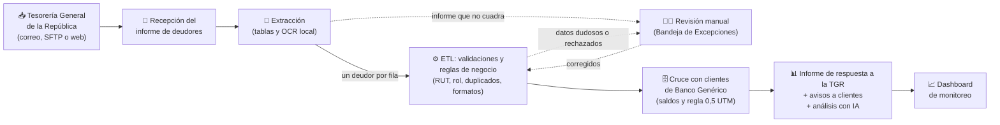

# TTDH Automation

> Plataforma para la automatización del procesamiento e integración de información de registros de deudores entre la **Tesorería General de la República** y **Banco Genérico**.


-blue)


Proyecto **Capstone (APT)** de la carrera de Ingeniería en Informática — Duoc UC, Sede Padre Alonso de Ovalle.

---

## 📑 Tabla de contenidos

- [Descripción](#-descripción)
- [Problema que resuelve](#-problema-que-resuelve)
- [Arquitectura de la solución](#-arquitectura-de-la-solución)
- [Características principales](#-características-principales)
- [Requerimientos funcionales](#-requerimientos-funcionales)
- [Stack tecnológico](#-stack-tecnológico)
- [Estructura del repositorio](#-estructura-del-repositorio)
- [Instalación y ejecución](#-instalación-y-ejecución)
- [Metodología y planificación](#-metodología-y-planificación)
- [Equipo](#-equipo)
- [Licencia](#-licencia)

---

## 📌 Descripción

**TTDH Automation** es una plataforma informática que automatiza el procesamiento de información de registros de deudores, desde su recepción —por correo electrónico, SFTP o carga web, en Excel, CSV, TXT, Word, PDF, documentos escaneados o fotografías— y validación hasta el cruce con las bases de datos de la organización y la generación de reportes.

La solución incorpora un módulo de **extracción** que lee el informe de deudores en cualquiera de esos formatos (con **OCR local, Tesseract**, para escaneos y fotografías) y lo convierte en una fila por deudor, y un proceso **ETL** capaz de trabajar con distintos formatos de archivos, aplicar reglas de validación y de negocio, detectar cambios respecto de procesos anteriores y mantener la trazabilidad de cada ejecución. Además, permite generar reportes parametrizables e integra un componente de **Inteligencia Artificial** para apoyar la detección de anomalías y sugerir nuevas validaciones.

## 🎯 Problema que resuelve

El procesamiento manual de grandes volúmenes de datos de deudores —recibir, revisar, validar, cruzar y analizar información— es propenso a errores, duplicidad de tareas, dificultad para detectar inconsistencias y limitada trazabilidad.

TTDH Automation busca:

- ✅ Automatizar y centralizar el procesamiento de los datos.
- ✅ Detectar cambios e inconsistencias entre ejecuciones.
- ✅ Mantener trazabilidad histórica de cada proceso.
- ✅ Generar reportes parametrizables.
- ✅ Reducir errores asociados a tareas manuales y mejorar la eficiencia del proceso.

## 🏗 Arquitectura de la solución

El flujo general de la plataforma es el siguiente:



1. **Entrada:** la Tesorería General de la República envía por correo institucional un **informe de deudores** (también se acepta SFTP y carga web) en Excel, CSV, TXT, Word, PDF, documento escaneado o fotografía. Cada informe trae varios deudores: RUT, nombre, ID de demanda, N° de resolución, monto solicitado, tipo de embargo, expediente, tesorería y fecha del oficio.
   - **Extracción:** se lee la tabla del informe (directamente en Excel, CSV, TXT, Word y PDF con texto; con OCR local, Tesseract, en escaneos y fotografías, sin enviar documentos a servicios externos) y se verifican sus totales. Si el informe no cuadra, va completo a revisión manual; si un dato crítico (RUT, monto o expediente) se lee con menos de 90 % de confianza o falta un dato, el deudor se carga marcado para revisión (RN05).
2. **Procesamiento (ETL):** cada deudor se valida y normaliza con las reglas definidas por el equipo (RUT y dígito verificador, formato del expediente, fechas, monto obligatorio y duplicados) y se carga como caso. Lo que no cumple queda rechazado con su motivo, y el analista lo corrige o descarta en la **Bandeja de Excepciones** (RF05, CU05).
3. **Cruce de datos:** los casos se cruzan por RUT con los clientes de Banco Genérico. Si el saldo total de sus cuentas es menor a **0,5 UTM**, no se descuenta; si es mayor, se descuenta hasta cubrir la deuda (o todo el saldo, si no alcanza). Varias deudas de un mismo RUT se cubren de la más antigua a la más nueva.
4. **Trazabilidad:** se registra cada ejecución, manteniendo el historial y la comparación entre procesos.
5. **Salidas:** se genera el informe de respuesta a la TGR (a quién se le descontó, a quién no y por qué), los avisos a los clientes afectados y reportes parametrizables; un componente de IA detecta anomalías y sugiere validaciones.
6. **Monitoreo:** los resultados se visualizan en un dashboard de seguimiento.

### Estado de desarrollo

| Etapa | Estado |
|---|---|
| Recepción por correo, SFTP y carga web (RF01) | ✅ Implementada |
| Extracción del informe en Excel, CSV, TXT, Word, PDF, escaneo y foto (RF02, RF12) | ✅ Implementada |
| ETL con las reglas de validación (RF03), con trazabilidad por deudor | ✅ Implementado |
| Bandeja de Excepciones para la revisión manual (RF05, CU05) | ✅ Implementada |
| Cruce con clientes de Banco Genérico y regla de 0,5 UTM (RF04) | ⬜ Pendiente |
| Informe de respuesta a la TGR, avisos a clientes y exportación (RF07, RF11) | ⬜ Pendiente |
| Dashboard (RF06), IA (RF08), usuarios y roles (RF09) | ⬜ Pendiente |

## ✨ Características principales

- Recepción automática de documentos desde la casilla de correo institucional, SFTP o carga web.
- Soporte para Excel, CSV, TXT, PDF, documentos escaneados y fotografías.
- Extracción de datos con OCR local (Tesseract), con nivel de confianza por registro y revisión manual de los datos dudosos.
- Proceso ETL configurable (extracción, transformación, validación y carga).
- Validaciones automáticas: RUT, duplicados, campos incompletos y formatos.
- Aplicación de reglas de negocio.
- Cruce e integración con bases de datos existentes.
- Comparación histórica y trazabilidad de ejecuciones.
- Reportes parametrizables y exportables.
- Componente de Inteligencia Artificial para detección de anomalías.
- Dashboard de monitoreo de procesos.

## 📋 Requerimientos funcionales

> Fuente oficial: *Documento de Especificación de Requerimientos (ERS)*.

| Código | Requerimiento | Descripción |
|--------|---------------|-------------|
| RF01 | Recepción Multicanal y Multiformato de Documentos TGR | El sistema debe recibir los documentos TGR por correo electrónico institucional, SFTP o carga web, en formatos estructurados (Excel, CSV, TXT) y no estructurados (PDF, escaneos y fotografías). |
| RF02 | Parsing y Extracción Automatizada | El sistema debe parsear los archivos TGR, identificando encabezados, detalle de transacciones y sumatorias de control. |
| RF03 | Motor de Validación de Datos | El sistema debe aplicar las reglas de validación (RUT, duplicados, campos obligatorios y formato) antes del cruce. |
| RF04 | Cruce Automático con Banco Genérico | El sistema debe cruzar la información TGR con el Core Bancario de Banco Genérico. |
| RF05 | Gestión de Excepciones y Rechazos | El sistema debe categorizar automáticamente las causas de rechazo y derivar las excepciones a revisión manual. |
| RF06 | Dashboard Analítico e Interactivo | El sistema debe presentar un dashboard con métricas en tiempo real, estados de conciliación y KPIs. |
| RF07 | Generación de Reportes de Salida TGR | El sistema debe generar los archivos de respuesta de rendición para la TGR con la estructura exigida. |
| RF08 | Módulo de Inteligencia Artificial Analítica | El sistema debe incorporar IA para interpretar tendencias de rechazo, detectar anomalías y resumir hallazgos. |
| RF09 | Gestión de Roles y Permisos (RBAC) | El sistema debe administrar usuarios con roles diferenciados (RBAC). |
| RF10 | Módulo de Auditoría y Trazabilidad Total | El sistema debe registrar una bitácora inalterable de todas las acciones realizadas. |
| RF11 | Exportación de Resultados y Métricas | El sistema debe exportar datasets y reportes en formatos estándar (Excel, PDF, CSV). |
| RF12 | Extracción y Normalización de Documentos (OCR/IA) | El sistema debe extraer los datos de PDF, escaneos y fotografías mediante extracción de tablas y OCR local (Tesseract), con un nivel de confianza por registro. |

## 🛠 Stack tecnológico

> Definido en la Fase 2 (ver *Guía 2.4* y *Plan de Calidad y Costos*). Todas las herramientas son de código abierto o ediciones gratuitas.

| Área | Tecnología |
|------|------------|
| Lenguaje / Backend (API) | Python + FastAPI |
| Base de datos | Microsoft SQL Server (Developer / Express) |
| Proceso ETL | Python + Pandas |
| Extracción de documentos (OCR) | Tesseract OCR, ejecutado localmente |
| Inteligencia Artificial | Python + Scikit-Learn |
| Frontend / Dashboard | React + Vite |
| Control de versiones | Git / GitHub |

## 📂 Estructura del repositorio

El repositorio sigue el formato de evidencias establecido para cada fase del Capstone:

```
CAPSTONE/
├── Fase 1/
│   ├── Evidencias Individuales/
│   └── Evidencias Grupales/
├── Fase 2/
│   ├── Evidencias Individuales/      # Apellido_Nombre_2.1_APT122_DiarioReflexionFase2.docx
│   ├── Evidencias Grupales/          # 2.4_GuiaEstudiante_Fase 2_DesarrolloProyecto APT (Español).docx
│   └── Evidencias Proyecto/
│       ├── Presentación Proyecto.pptx     # (pendiente)
│       ├── Evidencias de Documentación/   # planificación, análisis y diseño, actas de seguimiento
│       └── Evidencias de sistema/
│           ├── Aplicación/
│           │   ├── backend/          # Python + FastAPI
│           │   │   ├── app/
│           │   │   │   ├── main.py       # API REST (endpoints /api/...)
│           │   │   │   ├── config.py     # configuración desde backend/.env
│           │   │   │   ├── db.py         # conexión a SQL Server
│           │   │   │   └── modulos/      # recepcion, extraccion, etl, excepciones, validaciones,
│           │   │   │                     # cruce, trazabilidad, ia, reportes
│           │   │   ├── tests/            # pruebas con pytest
│           │   │   ├── requirements.txt
│           │   │   └── .env.example      # plantilla de configuración (copiar como .env)
│           │   ├── frontend/         # React + Vite: Ingesta, Casos TGR y Bandeja de Excepciones
│           │   └── data/
│           │       ├── simulados/    # informes de deudores ficticios en todos los formatos + manifiesto
│           │       └── muestra_tgr/  # CSV de muestra con el formato del ETL de Tomás
│           └── Base de datos/        # scripts SQL Server (01-08 y los de Tomás) y el ETL original
│                                     # en Pentaho (.ktr), que la aplicación reproduce en Python
├── Fase 3/
├── .gitignore
└── README.md
```

Cada paquete de `backend/app/modulos/` indica en su `__init__.py` qué requerimientos cubre y quién es su responsable.

## 🚀 Instalación y ejecución

> 🪟 **¿Primera vez en Windows?** Sigue la guía paso a paso [INSTALACION.md](INSTALACION.md): qué instalar, cómo configurar el `.env` y solución de los problemas más comunes. Esta sección es el resumen.

**Requisitos previos:**

- Python 3.12 o superior
- Node.js 20 o superior
- SQL Server 2019 o superior (Developer o Express) con `sqlcmd` y el *ODBC Driver 17 o 18 for SQL Server*
- Tesseract OCR (instalador para Windows: <https://github.com/UB-Mannheim/tesseract/wiki>, con el idioma español)

**1. Clonar el repositorio**

```bash
git clone https://github.com/JS-Ranker/CAPSTONE.git
cd CAPSTONE
```

**2. Base de datos** (autenticación de Windows; `-f 65001` es necesario para que los acentos se lean bien)

```bash
cd "Fase 2/Evidencias Proyecto/Evidencias de sistema/Base de datos"
sqlcmd -S localhost -E -C -f 65001 -i 01_crear_base_datos.sql
sqlcmd -S localhost -E -C -f 65001 -i 02_tablas.sql
sqlcmd -S localhost -E -C -f 65001 -i 03_datos_iniciales.sql
sqlcmd -S localhost -E -C -f 65001 -i 04_recepcion.sql
sqlcmd -S localhost -E -C -f 65001 -i 05_remitentes.sql
sqlcmd -S localhost -E -C -f 65001 -i creacion_db.sql
sqlcmd -S localhost -E -C -f 65001 -i recepcion_datos_input.sql
sqlcmd -S localhost -E -C -f 65001 -i creacion_tablas.sql
sqlcmd -S localhost -E -C -f 65001 -i 06_etl.sql
sqlcmd -S localhost -E -C -f 65001 -i 07_revisiones.sql
sqlcmd -S localhost -E -C -f 65001 -i 08_word.sql
```

> Con SQL Server Express el servidor suele ser `localhost\SQLEXPRESS` en lugar de `localhost` (aquí y en `DB_SERVER` del `.env`).
>
> `02_tablas.sql` recrea las tablas desde cero: borra los datos existentes. Después de ejecutarlo hay que volver a ejecutar todos los scripts siguientes. El resto no borra datos y se puede ejecutar más de una vez:
>
> | Script | Qué crea |
> |---|---|
> | `04_recepcion.sql` / `05_remitentes.sql` | Datos del correo y huella del archivo en `Archivos_TGR`; remitentes autorizados |
> | `creacion_db.sql`, `recepcion_datos_input.sql`, `creacion_tablas.sql` | Modelo de casos de Tomás: esquemas `stg`, `core` y `etl`, `stg.casos_tgr` y `core.casos_tgr` |
> | `06_etl.sql` | `etl.ejecuciones` y `etl.resultados`: resultado del ETL por deudor (cargado, rechazado con motivo o duplicado) |
> | `07_revisiones.sql` | `etl.revisiones`: historial de la revisión manual (Bandeja de Excepciones) |
> | `08_word.sql` | Agrega el tipo `Word` a `Archivos_TGR` |

**3. Backend (Python)**

```bash
cd "Fase 2/Evidencias Proyecto/Evidencias de sistema/Aplicación/backend"
python -m venv .venv
.venv\Scripts\activate             # en Linux/macOS: source .venv/bin/activate
pip install -r requirements.txt
copy .env.example .env             # en Linux/macOS: cp .env.example .env  (luego ajustar los valores)
python -m pytest                   # verifica la API y la conexión a la base de datos
uvicorn app.main:app --reload      # API en http://localhost:8000 (documentación en /docs)
```

**4. Frontend (React)**, en otra terminal

```bash
cd "Fase 2/Evidencias Proyecto/Evidencias de sistema/Aplicación/frontend"
npm ci
npm run dev                        # aplicación en http://localhost:5173
```

La aplicación tiene tres pantallas (al pie del menú se ve si la API y la base de datos están conectadas):

| Pantalla | Para qué sirve |
|---|---|
| **Ingesta** | Cargar informes; recepción automática por correo y SFTP (con remitentes autorizados); lista de **Informes recibidos** con su estado y cuántos deudores quedan por revisar. El detalle de cada informe muestra el documento original, el resultado del ETL y su historial. |
| **Casos TGR** | Casos cargados (búsqueda por RUT, nombre o rol, y filtro de revisión manual) y filas rechazadas con el estado de su revisión. |
| **Excepciones** | Bandeja de revisión manual: completar y regularizar los casos dudosos, corregir y cargar o descartar las filas rechazadas, siempre con observación e historial. |

Casos TGR y Excepciones se pueden filtrar por **N° de informe**, para ver todos los deudores de un informe (por ejemplo `http://localhost:5173/#/casos?informe=808`).

**5. Recepción de documentos (RF01)**

- **Carga web:** `POST /api/recepcion/archivos` (campo `archivo`). Los informes recibidos están en `GET /api/recepcion/archivos`. El resto de la API (casos, rechazados, excepciones, ETL) se puede probar desde `http://localhost:8000/docs`.
- **Extracción y ETL:** todo informe recibido queda "Pendiente de Extracción" y se procesa en segundo plano; si se lee bien, sus deudores pasan al ETL en la misma operación y el informe queda "Procesado". El CSV `resultado_tgr_*.csv` del formato de Tomás (ya extraído) va directo al ETL.
- **Correo y SFTP:** se revisan con un script, pensado para el Programador de tareas de Windows (por ejemplo, cada 5 minutos):

  ```bash
  cd "Fase 2/Evidencias Proyecto/Evidencias de sistema/Aplicación/backend"
  python -m scripts.revisar_canales --simular   # muestra lo que haría, sin registrar nada
  python -m scripts.revisar_canales             # correo, directorio SFTP y extracción de PDF/imágenes
  ```

  La casilla de correo y el directorio SFTP se configuran en `backend/.env` (ver `.env.example`); los remitentes autorizados se administran desde la pantalla de Ingesta (botón "Editar" junto a "Remitentes"). Los originales se guardan en `Aplicación/data/entrada/`, que está excluida del repositorio.

> **Importante:** no subir al repositorio datos reales de deudores ni credenciales. Utilizar datos de prueba o simulados y un archivo `.gitignore` adecuado.

## 📅 Metodología y planificación

El proyecto se desarrolla con metodología **en cascada**, avanzando por etapas y verificando el cumplimiento de cada una antes de continuar:

1. Levantamiento y análisis de requerimientos
2. Diseño (arquitectura, modelo de datos, ETL, interfaces)
3. Desarrollo
4. Pruebas
5. Implementación y documentación
6. Cierre

**Ajustes de la Fase 2 (Guía 2.4):** en la etapa de desarrollo los módulos se construyen en paralelo, con pruebas unitarias al cierre de cada uno e integración progresiva; se priorizó un flujo mínimo de extremo a extremo antes de las funciones avanzadas (OCR de fotografías e IA).

**Duración estimada:** 18 semanas — Fase 1 (definición, 4 semanas), Fase 2 (desarrollo, 10 semanas) y Fase 3 (pruebas finales, correcciones y presentación).

## 👥 Equipo

**Equipo STARTAB** — Ingeniería en Informática, Duoc UC (Sede Padre Alonso de Ovalle)

| Integrante | Rol principal |
|------------|---------------|
| María Trinidad Gaete Mella | Análisis de requerimientos, documentación y coordinación general |
| Tomas Catalán Madariaga | Diseño e implementación de bases de datos y procesos ETL |
| David Muñoz Bravo | Desarrollo de la aplicación, validaciones, reglas de negocio y reportes |
| Héctor Sanhueza Castro | Componente de análisis con IA, pruebas e integración |

## 📄 Licencia

Proyecto desarrollado con fines **académicos** en el marco de la asignatura Capstone (Portafolio de Título) de Duoc UC. Uso educativo.

---

<p align="center">Desarrollado por el equipo STARTAB · Duoc UC · 2026</p>